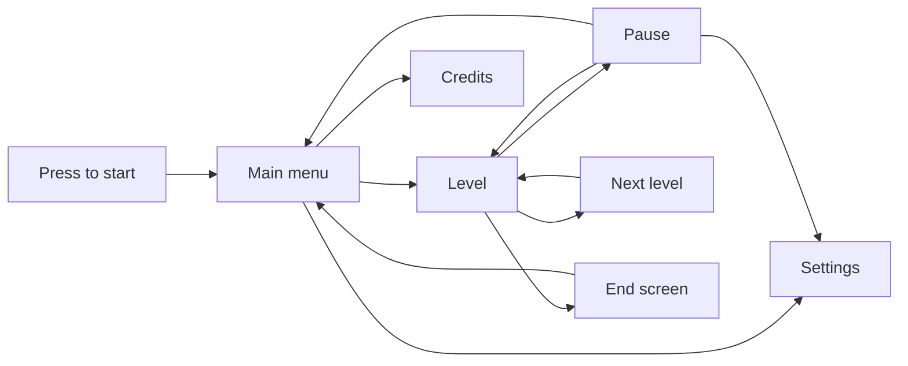

# Controls and UI

Controls, UI prototype and menu flow ([PRG-8](https://github.com/IES-Rafael-Alberti/gameoff2026-atomiclemonstudio/issues/138), [PRG-11](https://github.com/IES-Rafael-Alberti/gameoff2026-atomiclemonstudio/issues/153), [PRG-14](https://github.com/IES-Rafael-Alberti/gameoff2026-atomiclemonstudio/issues/158)).

## Controls
| Action | Keyboard | Gamepad (Xbox layout) | Touch |
|---|---|---|---|
| Move | WASD | Left stick / D-pad | Virtual stick |
| Jump | Space | A (bottom) | A button |
| Interact (switches, keys) | E | X (left) | X button |
| Restart screen | R | Y (top) | Y button |
| Turn left disc (clockwise) | Left Shift | L1 | Left lever |
| Turn right disc (counterclockwise) | Right Shift | R1 | Right lever |
| Pause | Esc _(proposal)_ | Start _(proposal)_ | Pause button _(proposal)_ |

- **Everything is remappable** from Settings, so the game can be played with one hand or adapted to a permanent or temporary disability.
- **Windows Sticky Keys:** pressing Shift 5 times opens that prompt. The game warns about it the first time and offers to remap.
- **Touch:** it is the gamepad adapted to the screen. The discs are turned with two levers, one on each side.

## HUD
The HUD is the Chromoscope itself:
- **Viewer frame:** the plastic rim shows at the edges of the screen.
- **Discs:** you see the ones you have and the position of each.
- **Active color:** shown by the scenery tint and by the discs.
- **Hint available:** _(pending)_.

## Menu flow

| Screen | Options |
|---|---|
| Press to start | Unlocks audio in the browser |
| Main menu | Play / Continue _(proposal)_, Settings, Credits |
| Pause | Resume, Restart screen, Settings, Quit to menu |
| Settings | Controls (remapping), music and SFX volume, fullscreen, colorblind mode _(if time allows)_ |
| End screen | Credits and back to menu |

Level select: _(pending)_. Progress saving: automatic when a level is completed _(proposal)_.
