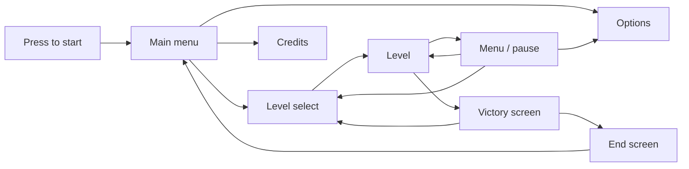

# Controls and UI

Controls, UI prototype and menu flow ([PRG-8](https://github.com/IES-Rafael-Alberti/gameoff2026-atomiclemonstudio/issues/138), [PRG-11](https://github.com/IES-Rafael-Alberti/gameoff2026-atomiclemonstudio/issues/153), [PRG-14](https://github.com/IES-Rafael-Alberti/gameoff2026-atomiclemonstudio/issues/158)).

## Controls
| Action | Keyboard | Gamepad (Xbox layout) | Touch |
|---|---|---|---|
| Move | WASD | Left stick / D-pad | Virtual stick |
| Jump | Space | A (bottom) | A button |
| Interact (switches, locks) | F | X (left) | X button |
| Restart level | L | Y (top) | Y button |
| Turn left disc (next position) | Q | L1 | Left lever |
| Turn right disc (next position) | E | R1 | Right lever |
| Left disc, direct to a color | 1 clear, 2 red, 3 blue, 4 yellow | — | — |
| Right disc, direct to a color | 5 clear, 6 red, 7 blue, 8 yellow | — | — |
| Menu (acts as pause) | Tab | Start _(proposal)_ | Menu button _(proposal)_ |

- **Direct keys:** the number keys turn the disc straight to a color. The right disc uses the same color order as the left one, shifted to the next keys. Q and E move the discs sequentially.
- **Picking up a brush** needs no key: it is collected by touching it. F is used to interact with the object it opens.
- **Everything is remappable** from Options > Controls, so the game can be played with one hand or adapted to a permanent or temporary disability. There is a screen for players with any kind of difficulty to change the controls.
- **Touch:** it is the gamepad adapted to the screen. The discs are turned with two levers, one on each side.

## HUD
The HUD is the Chromoscope itself:
- **Viewer frame:** the plastic rim shows at the edges of the screen.
- **Discs:** you see the ones you have and the position of each.
- **Active color:** shown by the scenery tint and by the discs.
- **Hint:** permanent, always visible in the level.

## Menu flow

| Screen | Options |
|---|---|
| Press to start | Unlocks audio in the browser |
| Main menu | Play / Continue _(proposal)_, Options, Credits |
| Level select | Super Mario style map. Pick any level you have unlocked |
| Menu (Tab) | It is also the pause. Quit game, level, options |
| Options | Sound, controls (remapping) and accessibility (colorblind mode _(if time allows)_) |
| Victory screen | Shown when a level is completed; a final cutscene is possible after level 8 |
| End screen | Credits and back to menu |

Progress saving: automatic when a level is completed _(proposal)_.
